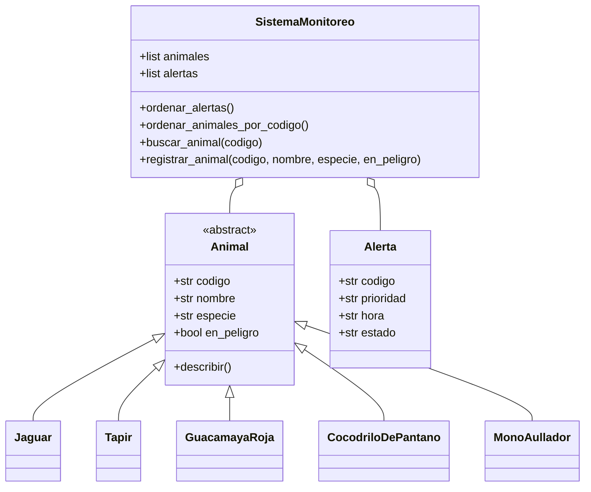

# Guardianes del Petén - Entrega 4

**Estudiante:** Yancy Samantha Jimena Lopez Davila  
**Carné:** 202605658  
**Grupo:** 2  
**Fecha:** 8 de noviembre de 2026  
**Curso:** Fundamentos de Programación 2

## Descripción
Sistema de monitoreo de fauna en el Petén. Conservo las funciones de registro,
collares, zonas, guardarrecursos, lecturas, alertas, batería y movimientos de las
Entregas 1 y 2, y la herencia y el polimorfismo de cinco especies de la Entrega 3.

## Novedades de la Entrega 4

1. **Ordenar alertas:** `SistemaMonitoreo.ordenar_alertas()` usa selección,
   sin `sort()` ni `sorted()`, con prioridad alta antes de media y hora ascendente
   dentro de cada prioridad. Para ello incorporé el atributo `hora` a `Alerta`.
2. **Buscar animales:** `SistemaMonitoreo.ordenar_animales_por_codigo()` usa
   selección, luego `buscar_animal(codigo)` aplica búsqueda binaria con
   `inicio`, `fin` y `medio`. Devuelve un objeto o `None`.
3. **Pruebas:** `main.py` muestra seis alertas antes y después del ordenamiento
   y busca el primer código, el último y uno inexistente.

## Diagrama de clases actualizado



## Ejecución (Windows)

En la carpeta del proyecto, abre CMD y ejecuta:

```bash
py main.py
```

En Linux o macOS: `python3 main.py`.

## Evidencia

Ver `captura_ejecucion.png`, salida completa comprobada de `main.py`.
